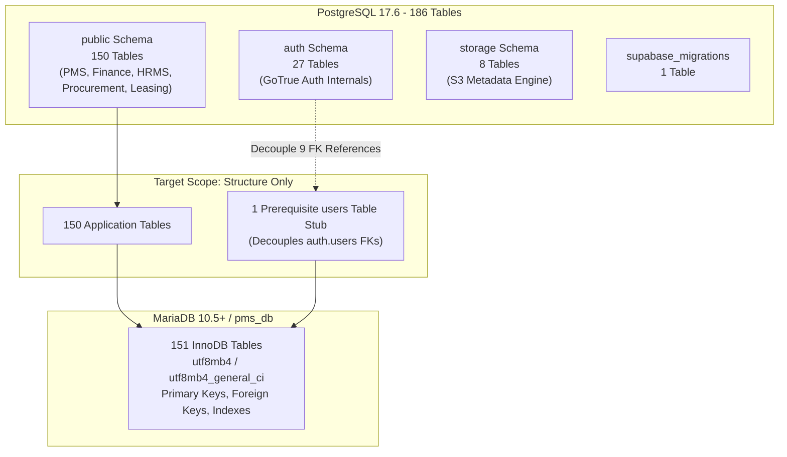
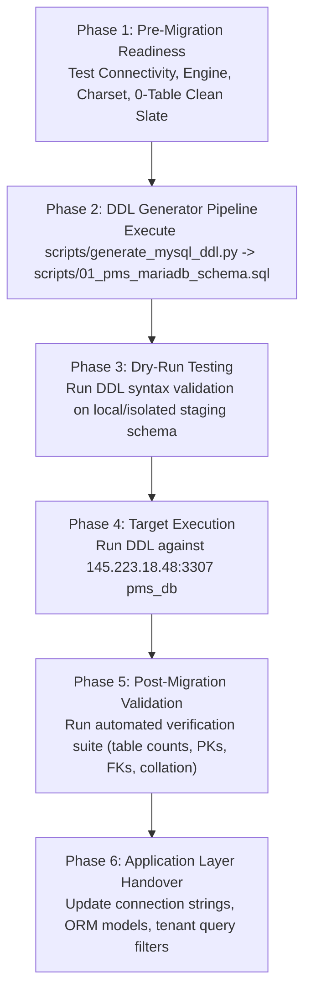

# End-to-End Migration Plan: Supabase PostgreSQL to MySQL (MariaDB 10.5+)

## Executive Overview

This document presents the definitive, production-grade **Database Migration Plan, Schema Translation Architecture, and Verification Framework** for migrating the **Property Management System (PMS)** from **Supabase PostgreSQL 17.6** to the target **MariaDB 10.5.27 (InnoDB)** instance.

Per strict user requirements, this migration encompasses **Table Schema, Structural Constraints, Indexes, and Relational Architecture Only** (excluding all data rows).

---

## 1. Target Database Profile & Readiness Assessment

Live network inspection and parameter auditing of the target database host yielded the following environment profile:

| Attribute | Specification | Production Assessment & Readiness |
| :--- | :--- | :--- |
| **Host & Port** | `145.223.18.48:3307` | Dedicated external port `3307` accessible over TCP. |
| **Database Name** | `pms_db` | Target schema isolated and dedicated to the PMS application. |
| **Target Engine & Version** | `10.5.27-MariaDB-ubu2004` | Ubuntu 20.04 LTS host running MariaDB 10.5.27. |
| **Storage Engine** | `InnoDB` (`innodb_file_per_table=ON`) | Full ACID compliance, crash recovery, and ANSI foreign keys. |
| **Character Set & Collation** | `utf8mb4` / `utf8mb4_general_ci` | Native 4-byte UTF-8 support (emojis, Arabic, multilingual text). |
| **Casing Configuration** | `lower_case_table_names = 1` | Table names stored in lowercase and comparisons case-insensitive. Guarantees cross-platform portability. |
| **Current Target State** | Clean Empty Slate (`0` tables) | No existing tables, views, or routines in `pms_db`. Clean migration target. |
| **User Privileges (`pms_user`)** | `ALL PRIVILEGES ON pms_db.*` | Unrestricted permissions to `CREATE`, `ALTER`, `DROP`, `INDEX`, `REFERENCES`, and `CREATE VIEW`. |
| **Packet Size** | `max_allowed_packet = 16MB` | Sufficient for large DDL batch executions. |
| **Foreign Key Enforcement** | `FOREIGN_KEY_CHECKS = ON` | Strict relational integrity enabled by default. Must be wrapped with `SET FOREIGN_KEY_CHECKS = 0;` during initial DDL script execution to resolve circular dependencies. |

---

## 2. Supabase PostgreSQL Schema Inventory & Breakdown

The source Supabase export (`supabase_export/01_architecture_and_schema.sql`) contains the complete application and platform architecture dumped from PostgreSQL 17.6:



### 2.1 Schema Breakdown & Object Inventory

- **Total PostgreSQL Tables**: 186 tables across 4 schemas.
- **In-Scope Application Tables**: **150 tables** in `public` schema.
- **Total Columns**: 2,036 column definitions.
- **Primary Keys**: 186 PKs (110 UUID, 28 Serial/Integer, 19 Text/Natural Keys, composite PKs).
- **Foreign Keys**: ~165 active foreign keys in `public` (including 9 referencing `auth.users`).
- **Unique Constraints**: 83 UNIQUE constraints.
- **Secondary Indexes**: 98 BTREE indexes, 5 partial indexes.
- **Custom ENUMs**: 20 total types (10 in `public`, 9 in `auth`, 1 in `storage`).
- **Programmability**:
  - **49 Functions (PL/pgSQL)**: Stored routines, accounting balancing, UUID generators.
  - **20 Triggers**: 14 `updated_at` timestamp triggers, 2 COA validation triggers.
  - **1 View**: `public.v_posting_engine_compliance`.
  - **94 Row Level Security (RLS) Policies**: Across 138 tables.

---

## 3. PostgreSQL to MySQL Conversion Rules & Architecture Trade-offs

### 3.1 Comprehensive Data Type Mapping Matrix

MariaDB 10.5.27 requires specific mapping adaptations due to architectural differences from PostgreSQL 17.6 and MySQL 8.0:

| PostgreSQL Type | Source Count | Target Type (MariaDB 10.5+) | Architecture Rationale & Trade-offs |
| :--- | :--- | :--- | :--- |
| `uuid` | 417 | `VARCHAR(36)` | MariaDB 10.5 lacks a native 16-byte UUID data type (introduced in 10.7+). `VARCHAR(36)` stores the canonical 36-character hyphenated UUID (`xxxxxxxx-xxxx-xxxx-xxxx-xxxxxxxxxxxx`). Default generation uses `DEFAULT (UUID())`. |
| `text` | 823 | `TEXT` / `VARCHAR(255)` | Long text and descriptions map to `TEXT`. Short codes, slugs, names, and status codes map to `VARCHAR(255)`. |
| `character varying(n)` | 16 | `VARCHAR(n)` | Direct 1:1 mapping preserving exact length bounds. |
| `timestamptz` | 297 | `DATETIME(6)` | PostgreSQL `timestamptz` stores UTC with timezone awareness. MariaDB `DATETIME(6)` provides microsecond precision and avoids the MariaDB/MySQL 32-bit `TIMESTAMP` year 2038 limit (range: '1000-01-01' to '9999-12-31'). Applications persist timestamps in UTC. |
| `timestamp` | 4 | `DATETIME(6)` | Direct 1:1 mapping with microsecond precision. |
| `date` | 112 | `DATE` | Direct 1:1 mapping ('1000-01-01' to '9999-12-31'). |
| `time` | 2 | `TIME(6)` | Direct 1:1 mapping. |
| `boolean` | 92 | `TINYINT(1)` / `BOOLEAN` | In MariaDB, `BOOLEAN` is an alias for `TINYINT(1)` where `1 = TRUE`, `0 = FALSE`. |
| `integer` (`int4`) | 114 | `INT` | Signed 32-bit integer (-2,147,483,648 to 2,147,483,647). |
| `bigint` (`int8`) | 24 | `BIGINT` | Signed 64-bit integer. |
| `numeric(p, s)` | 84 | `DECIMAL(p, s)` | Exact monetary and financial precision (e.g. `DECIMAL(18,2)`, `DECIMAL(18,4)`). |
| `numeric` (unconstrained) | 107 | `DECIMAL(18, 4)` | PostgreSQL permits unbounded `numeric`. In MariaDB, decimal precision must be declared; `DECIMAL(18, 4)` provides the enterprise standard for general accounting and quantities in PMS. |
| `jsonb` / `json` | 49 | `JSON` | In MariaDB 10.5, `JSON` is an alias for `LONGTEXT` with an automated `CHECK (JSON_VALID(col))` constraint. Compatible with `JSON_EXTRACT` and `JSON_UNQUOTE`. |
| `text[]` (Array) | 8 | `JSON` | MariaDB lacks native array types. PostgreSQL arrays (`text[]`) map to `JSON` arrays (e.g. `["url1", "url2"]`). Defaults like `'{}'::text[]` translate to `'[]'`. |
| `geography(POINT, 4326)` | 1 | `POINT` | Used in `properties.location_coordinates`. MariaDB 10.5 supports `POINT` with spatial functions (`ST_AsText`, `ST_GeomFromText`) and spatial indexes. |
| Custom ENUMs (20 types) | 27 | `ENUM(...)` / `VARCHAR(64)` | Lifecycle status enums map to `ENUM(...)`. Large dynamic enums map to `VARCHAR(64)` to permit schema evolution without table rebuild locks. |

---

### 3.2 Key Architecture Trade-offs & Resolutions

#### A. Decoupling Supabase `auth.users` Foreign Keys
In Supabase, user authentication records reside in the internal `auth.users` table. In the `public` schema, exactly **9 tables** enforce foreign keys to `auth.users(id)`:
1. `customers.verified_by` (`ON DELETE SET NULL`)
2. `key_handovers.staff_id` (`ON DELETE SET NULL`)
3. `leases.created_by` (`ON DELETE SET NULL`)
4. `profiles.id` (`ON DELETE CASCADE` - 1:1 user profile)
5. `reservations.marketing_agent_id` (`ON DELETE SET NULL`)
6. `system_configurations.updated_by` (`ON DELETE SET NULL`)
7. `system_notifications.target_user` (`ON DELETE CASCADE`)
8. `tenant_organisations.admin_user_id` (`ON DELETE SET NULL`)
9. `tenant_organisations.onboarded_by` (`ON DELETE SET NULL`)

**Resolution**: Rather than importing 27 internal Supabase auth tables into MariaDB, we introduce a lightweight application `users` identity table in `pms_db` before creating public tables:
```sql
CREATE TABLE IF NOT EXISTS `users` (
    `id` VARCHAR(36) NOT NULL,
    `email` VARCHAR(255) NULL,
    `raw_user_meta_data` JSON NULL,
    `created_at` DATETIME(6) NOT NULL DEFAULT CURRENT_TIMESTAMP(6),
    `updated_at` DATETIME(6) NOT NULL DEFAULT CURRENT_TIMESTAMP(6) ON UPDATE CURRENT_TIMESTAMP(6),
    PRIMARY KEY (`id`),
    UNIQUE KEY `uq_users_email` (`email`)
) ENGINE=InnoDB DEFAULT CHARSET=utf8mb4 COLLATE=utf8mb4_general_ci;
```
All 9 foreign key constraints are repointed to `users(id)`, preserving 100% referential integrity.

#### B. Storage Metadata (`storage.*`)
Inspection of all 150 public tables confirms **0 foreign keys to `storage.*`**. The PMS application stores document URLs, inspection photos, and lease contract attachments as URL strings or JSON arrays pointing to object storage (S3 / MinIO / Cloudflare R2). No storage engine tables are needed in MariaDB.

#### C. Handling the Lack of Row Level Security (RLS) in MySQL/MariaDB
- **PostgreSQL**: Supabase relied on PostgreSQL RLS (`ALTER TABLE ... ENABLE ROW LEVEL SECURITY`) with 94 policies enforcing tenant isolation (`tenant_id = auth.jwt() ->> 'tenant_id'`).
- **MariaDB Limitation**: MariaDB/MySQL does not have a native Row Level Security engine.
- **Architectural Transition**: Multi-tenancy and data isolation must be enforced at the **Application / ORM / Middleware Layer**:
  1. **Query Scoping**: Every database query generated by backend services, Prisma, TypeORM, or raw SQL queries must include explicit tenant isolation: `WHERE tenant_id = :tenantId`.
  2. **API Middleware**: JWT verification middleware extracts the authenticated `tenant_id` and injects it into every repository and transaction context.
  3. **Super-Admin Bypass**: Super-admin queries must be explicitly isolated to administrative endpoints.

#### D. Procedural Logic & Financial Posting Engine
- In PostgreSQL, 49 stored procedures handled complex tasks like atomic financial voucher posting (`post_accounting_event_atomic`), debit/credit balancing, and PDC transitions.
- **Transition**: Migrate transactional financial business logic into **Application Service Layer methods** wrapped in strict database transactions (`START TRANSACTION; ... COMMIT;`) using pessimistic locking (`SELECT ... FOR UPDATE`) to guarantee consistency and balance integrity.

#### E. Trigger Elimination via Native MariaDB Column Clauses
- In PostgreSQL, updating `updated_at` timestamps required 14 procedural triggers calling `fin_set_updated_at()` and `proc_set_updated_at()`.
- **Optimization**: Replaced entirely by native MariaDB column definitions:
  ```sql
  `updated_at` DATETIME(6) NOT NULL DEFAULT CURRENT_TIMESTAMP(6) ON UPDATE CURRENT_TIMESTAMP(6)
  ```
  This eliminates 14 procedural triggers and reduces transaction write overhead.

---

## 4. Circular Foreign Keys & Topological Execution Strategy

### 4.1 Circular Dependency Analysis
Analysis of the PMS database schema identified **8 tables involved in circular foreign key relationships**:
1. `fin_accounting_events` ⇄ `fin_vouchers`:
   - `fin_accounting_events.voucher_id` references `fin_vouchers(id)`
   - `fin_vouchers.accounting_event_id` references `fin_accounting_events(id)`
2. `leases` ⇄ `inspection_reports`:
   - `leases.move_in_inspection_id` references `inspection_reports(id)`
   - `inspection_reports.lease_id` references `leases(id)`
3. Dependent cyclical branches:
   - `fin_accounting_event_lines`, `fin_voucher_lines`, `erp_journal_entries`, `key_handovers`.

### 4.2 Safe Execution Wrapper Strategy
In MariaDB/MySQL, creating tables with mutual references without disabling foreign key checks causes fatal `ERROR 1215 (HY000): Cannot add foreign key constraint`.

To guarantee 100% deterministic and idempotent execution, the entire DDL script is wrapped in foreign key check suppression:

```sql
-- =====================================================================
-- DDL EXECUTION HEADER
-- =====================================================================
SET NAMES utf8mb4;
SET FOREIGN_KEY_CHECKS = 0;
SET SQL_MODE = 'STRICT_TRANS_TABLES,NO_ENGINE_SUBSTITUTION';
SET AUTOCOMMIT = 0;
START TRANSACTION;

-- 1. Identity prerequisite
CREATE TABLE IF NOT EXISTS `users` ( ... );

-- 2. 150 Application Tables in topological groups
CREATE TABLE IF NOT EXISTS `properties` ( ... );
CREATE TABLE IF NOT EXISTS `units` ( ... );
...
CREATE TABLE IF NOT EXISTS `fin_accounting_events` ( ... );
CREATE TABLE IF NOT EXISTS `fin_vouchers` ( ... );

-- 3. Secondary Indexes and Unique Keys
...

-- 4. Application Views
CREATE OR REPLACE VIEW `v_posting_engine_compliance` AS ...;

-- =====================================================================
-- DDL EXECUTION FOOTER
-- =====================================================================
COMMIT;
SET FOREIGN_KEY_CHECKS = 1;
```

---

## 5. Edge Cases & Risk Assessment

| Potential Edge Case / Risk | Impact | Risk Level | Mitigation & Resolution Strategy |
| :--- | :--- | :--- | :--- |
| **MySQL Identifier Length Limit** | DDL Error | Low | MySQL/MariaDB limits table, column, and index names to **64 characters**. Analysis of all 150 tables and 2,036 columns confirms the longest table name is `fin_transaction_account_rule_audit` (34 chars) and longest column is `advance_rental_cheques_count` (28 chars). All identifiers fit comfortably within 64 chars. |
| **Reserved Keywords** | Syntax Error | Medium | PMS uses columns and tables named `condition`, `status`, `key`, `read`, `groups`, `order`, `system`. **All identifiers** in the generated DDL are enclosed in backticks (e.g. `` `condition` ``, `` `groups` ``). |
| **Partial / Filtered Indexes** | Incompatibility | Medium | PostgreSQL supports `CREATE UNIQUE INDEX ... WHERE (col IS NOT NULL)`. MariaDB BTREE indexes natively treat `NULL` as distinct, permitting multiple `NULL` values while enforcing uniqueness on populated values. Boolean filtered indexes (`WHERE is_active = true`) map to compound indexes `(is_active, ...)`. |
| **Case Sensitivity (`lower_case_table_names=1`)** | Query Failure | Low | Target server has `lower_case_table_names=1`. All table names in DDL are generated strictly in lowercase, preventing case mismatch errors between Windows and Linux hosts. |
| **Zero-Date & Strict SQL Mode** | Insert Error | Medium | MariaDB strict mode disallows `0000-00-00 00:00:00`. All datetime columns are configured with valid defaults (`CURRENT_TIMESTAMP(6)`) or are explicitly nullable. |
| **Multi-Tenancy Security Leak (No RLS)** | High | Critical | MySQL does not enforce RLS. All application queries must apply `WHERE tenant_id = :tenantId`. Recommend adding automated unit/integration test assertions verifying query scopes. |

---

## 6. Step-by-Step Phased Execution Roadmap



### Phase 1: Pre-Migration Readiness
- Verify external connectivity to `145.223.18.48:3307`.
- Verify user `pms_user` has `ALL PRIVILEGES` on `pms_db.*`.
- Confirm `pms_db` contains 0 tables.

### Phase 2: DDL Generator Pipeline
- Execute the schema translator script (`scripts/generate_mysql_ddl.py`) against `supabase_export/01_architecture_and_schema.sql`.
- Script generates:
  - Header: `SET FOREIGN_KEY_CHECKS = 0; SET NAMES utf8mb4;`
  - Table 1: `users` prerequisite stub.
  - Tables 2-151: 150 application tables mapped to `InnoDB` with MariaDB data types.
  - Secondary indexes and Unique constraints.
  - View `v_posting_engine_compliance`.
  - Footer: `COMMIT; SET FOREIGN_KEY_CHECKS = 1;`
- Output written to `scripts/01_pms_mariadb_schema.sql`.

### Phase 3: Dry-Run Validation
- Validate DDL syntax using a local MySQL/MariaDB dry-run parser to ensure zero syntax or constraint errors.

### Phase 4: Production DDL Execution
- Connect to `145.223.18.48:3307` and execute the generated SQL script:
  ```bash
  mysql -h 145.223.18.48 -P 3307 -u pms_user -p'lite$#20' pms_db < scripts/01_pms_mariadb_schema.sql
  ```

### Phase 5: Post-Migration Validation Checks
- Run the automated validation script (`scripts/verify_mysql_schema.py`).
- Assert exact match on table counts (151), engine (100% InnoDB), collations, and primary keys.

### Phase 6: Application & ORM Configuration
- Update `.env` or application configuration with target MySQL connection string:
  `mysql://pms_user:<DB_PASSWORD>@145.223.18.48:3307/pms_db`
- Regenerate ORM client (e.g. `npx prisma db pull` or `drizzle-kit introspect`).
- Enable application-level tenant isolation middleware.

---

## 7. Verification Checklist & Validation Test Suite

### 7.1 Database Verification Queries

| Verification Target | Expected Value | SQL Validation Query |
| :--- | :--- | :--- |
| **Total Table Count** | Exactly `151` (150 application + 1 `users` stub) | `SELECT COUNT(*) FROM information_schema.tables WHERE table_schema = 'pms_db' AND table_type = 'BASE TABLE';` |
| **Storage Engine** | `0` non-InnoDB tables (100% InnoDB) | `SELECT COUNT(*) FROM information_schema.tables WHERE table_schema = 'pms_db' AND engine != 'InnoDB';` |
| **Character Set** | `utf8mb4` across all tables | `SELECT COUNT(*) FROM information_schema.tables WHERE table_schema = 'pms_db' AND table_collation NOT LIKE 'utf8mb4%';` (Expect 0) |
| **Primary Key Enforcement** | Exactly `151` primary keys | `SELECT COUNT(DISTINCT table_name) FROM information_schema.table_constraints WHERE table_schema = 'pms_db' AND constraint_type = 'PRIMARY KEY';` |
| **Foreign Key Count** | ~`174` active foreign keys | `SELECT COUNT(*) FROM information_schema.table_constraints WHERE table_schema = 'pms_db' AND constraint_type = 'FOREIGN KEY';` |
| **Views** | Exactly `1` view (`v_posting_engine_compliance`) | `SELECT table_name FROM information_schema.views WHERE table_schema = 'pms_db';` |
| **Orphan FK References** | `0` invalid references | Verified by `FOREIGN_KEY_CHECKS = 1` commitment. |

### 7.2 Automated Verification Script (`scripts/verify_mysql_schema.py`)
```python
import pymysql

conn = pymysql.connect(
    host="145.223.18.48",
    port=3307,
    user="pms_user",
    password="lite$#20",
    database="pms_db"
)

with conn.cursor() as cursor:
    # 1. Check table count
    cursor.execute("SELECT COUNT(*) FROM information_schema.tables WHERE table_schema = 'pms_db' AND table_type = 'BASE TABLE'")
    table_count = cursor.fetchone()[0]
    assert table_count == 151, f"Expected 151 tables, got {table_count}"

    # 2. Check engine
    cursor.execute("SELECT COUNT(*) FROM information_schema.tables WHERE table_schema = 'pms_db' AND engine != 'InnoDB'")
    bad_engine = cursor.fetchone()[0]
    assert bad_engine == 0, f"Found {bad_engine} non-InnoDB tables"

    # 3. Check primary keys
    cursor.execute("SELECT COUNT(DISTINCT table_name) FROM information_schema.table_constraints WHERE table_schema = 'pms_db' AND constraint_type = 'PRIMARY KEY'")
    pk_count = cursor.fetchone()[0]
    assert pk_count == 151, f"Expected 151 primary keys, got {pk_count}"

    print("[SUCCESS] All 151 tables, engines, and primary keys verified successfully!")
```

---

## 8. Rollback & Disaster Recovery Plan

If any phase encounters an unrecoverable failure during execution, the database can be cleanly rolled back to its initial empty baseline in seconds:

```sql
-- Comprehensive Rollback Procedure
SET FOREIGN_KEY_CHECKS = 0;
DROP DATABASE IF EXISTS `pms_db`;
CREATE DATABASE `pms_db` CHARACTER SET utf8mb4 COLLATE utf8mb4_general_ci;
SET FOREIGN_KEY_CHECKS = 1;
```

This teardown script drops all partially created tables, indexes, and views, and re-initializes an empty `pms_db` database ready for re-execution.
